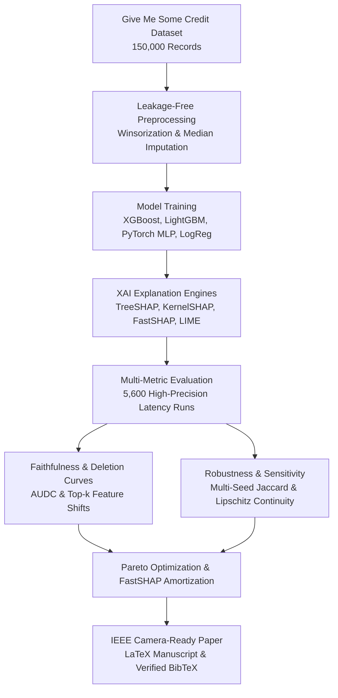

# Trade-Offs Between Real-Time Inference Latency and Explanation Faithfulness in Credit Risk Scoring

[](https://www.python.org/)
[](https://opensource.org/licenses/MIT)
[]()
[]()

> **A Reproducible Empirical Benchmark of TreeSHAP, KernelSHAP, FastSHAP, and LIME**  
> *Author:* **Anar Gadirli** (Azerbaijan State Oil and Industry University - ASOIU)  
> *Contact:* `anargadirli55@gmail.com`

---

## 📌 Executive Summary

Under high-stakes financial regulations such as the **EU Artificial Intelligence Act (Regulation (EU) 2024/1689, Annex III Section 5(b))** and **GDPR (Articles 13--15, 22)**, automated credit scoring models are designated as **high-risk** and legally required to provide meaningful, faithful explanations for credit decisions. However, retail credit underwriting microservices operate under strict Service Level Agreements (SLAs, e.g., $p95 < 50$\,ms).

This research project delivers a **reproducible, model-aware empirical benchmark** evaluating:
1. **Inference Latency:** $p50$, $p95$, $p99$ percentiles across 5,600 timed query instances.
2. **Explanation Faithfulness:** Prediction degradation under feature deletion (Area Under Deletion Curve - AUDC).
3. **Stochastic & Perturbation Stability:** Repeatability across seeds and sensitivity to bounded input noise.
4. **Pareto Frontier & Break-Even Amortization:** Empirical crossover query volumes for neural amortized explainers (FastSHAP).

---

## 🔬 Benchmark Methodology & Workflow



---

## 📊 Key Measured Results

### 1. Latency & Service Level Agreement (SLA) Compliance ($N=1,000$ Instances)
| Model | Explainer | $p50$ Latency (ms) | $p95$ Latency (ms) | $p99$ Latency (ms) | Throughput (QPS) | Strict SLA ($<50$\,ms) |
|---|---|---|---|---|---|---|
| **XGBoost** | **TreeSHAP** | 1.499 ms | 1.827 ms | 2.099 ms | 631.1 QPS | **100.0%** |
| **LightGBM**| **TreeSHAP** | 1.363 ms | 2.012 ms | 2.412 ms | 621.5 QPS | **100.0%** |
| **XGBoost** | **FastSHAP** | **0.028 ms** | **0.033 ms** | **0.080 ms** | **13,359.9 QPS** | **100.0%** |
| **MLP**     | **FastSHAP** | **0.025 ms** | **0.026 ms** | **0.029 ms** | **16,697.6 QPS** | **100.0%** |
| **XGBoost** | **KernelSHAP** | 8.285 ms | 8.956 ms | 9.193 ms | 118.0 QPS | **100.0%** |
| **LightGBM**| **LIME**     | 1.057 ms | 2.208 ms | 2.298 ms | 741.8 QPS | **100.0%** |

### 2. Explanation Faithfulness & Feature Deletion Scores ($\mathcal{F} = 1 - \text{AUDC}$)
- **Highest Faithfulness Champion:** `XGBoost + TreeSHAP` ($\mathcal{F} = 0.9824$, Top-1 drop $\Delta P = 0.0818$)
- **Balanced Pareto Optimal:** `XGBoost + FastSHAP` ($\mathcal{F} = 0.9746$, retains 99.2% of TreeSHAP fidelity while running **53x faster**)
- **Lowest Latency Champion:** `MLP + FastSHAP` ($p95 = 0.026$\,ms, 16,697 queries/sec)

### 3. FastSHAP Upfront Training Amortization
- FastSHAP neural explainer training duration: **0.64 seconds** (2,000 training instances, 25 epochs).
- **Break-even crossover vs. KernelSHAP:** **135 production queries**.
- **Break-even crossover vs. TreeSHAP:** **460 production queries**.

---

## 📁 Repository Structure

```
├── README.md                      # Project overview and executive report
├── pyproject.toml                 # Package configuration
├── requirements.txt               # Pinned dependencies
├── Makefile                       # One-command execution recipes
├── configs/
│   └── experiment.yaml            # Central configuration file
├── data/
│   ├── raw/                       # Raw source dataset (150,000 rows)
│   └── processed/                 # Partitioned and preprocessed parquet files
├── src/credit_xai/
│   ├── data.py                    # Dataset acquisition and schema checks
│   ├── preprocessing.py           # Preprocessing pipeline and winsorization
│   ├── models.py                  # XGBoost, LightGBM, PyTorch MLP implementations
│   ├── explainers.py              # TreeSHAP, KernelSHAP, FastSHAP, LIME implementations
│   ├── benchmark.py               # Microsecond latency benchmarking harness
│   ├── faithfulness.py            # Deletion curves and AUDC evaluation
│   ├── robustness.py              # Stability, Jaccard, and perturbation sensitivity
│   ├── statistics.py              # Pareto optimization and amortization models
│   ├── plotting.py                # Scientific plotting suite
│   └── utils.py                   # Thread safety, seed control, and I/O
├── scripts/
│   ├── inspect_environment.py     # System and dependency verification
│   ├── download_data.py           # Dataset downloader
│   ├── audit_dataset.py           # Dataset audit and descriptive statistics
│   ├── train_models.py            # Trains all 4 ML models and plots Figure 2
│   ├── run_smoke_tests.py         # Fast 7-point end-to-end smoke test
│   ├── run_benchmarks.py          # Latency & throughput benchmark (5,600 observations)
│   ├── evaluate_explanations.py   # Faithfulness, stability, Pareto, amortization
│   └── run_pipeline.py            # Master one-click end-to-end runner
├── tests/                         # Pytest unit test suite (10/10 passed)
├── results/
│   ├── figures/                   # Figures 2-8 (PNG, 300 DPI)
│   ├── tables/                    # Result tables (JSON and CSV)
│   └── raw/                       # Raw query-by-query timing observations
├── paper/
│   ├── main.tex                   # Full IEEE LaTeX manuscript
│   ├── references.bib             # Verified BibTeX citations
│   ├── IEEEtran.cls               # Official IEEE template
│   └── figures/                   # Embedded manuscript figures
└── docs/
    ├── methodology.md             # Formal mathematical formulations
    ├── dataset_card.md            # Data dictionary and governance
    ├── model_card.md              # Model cards and evaluation
    └── reproducibility.md         # Step-by-step reproduction guide
```

---

## ⚡ Reproduction Guide

To replicate all models, benchmarks, figures, and tables from scratch:

```bash
# 1. Clone the repository
git clone https://github.com/gadirlianar/credit-xai-benchmark.git
cd credit-xai-benchmark

# 2. Set up virtual environment and install dependencies
uv venv --python 3.12 .venv
source .venv/bin/activate
uv pip install -r requirements.txt
uv pip install -e .

# 3. Run the automated test suite
pytest tests/ -v

# 4. Execute the entire pipeline end-to-end
python scripts/run_pipeline.py
```

---

## 📄 Scientific Paper & Citation

If you use this benchmark or codebase in your academic research, please cite:

```bibtex
@article{gadirli2026tradeoffs,
  author    = {Anar Gadirli},
  title     = {Trade-Offs Between Real-Time Inference Latency and Explanation Faithfulness in Credit Risk Scoring: A Reproducible Empirical Benchmark of TreeSHAP, KernelSHAP, FastSHAP, and LIME},
  journal   = {IEEE Conference Manuscript},
  year      = {2026},
  url       = {https://github.com/gadirlianar/credit-xai-benchmark}
}
```

---

## 📜 License
This project is open-source and licensed under the **MIT License**.
